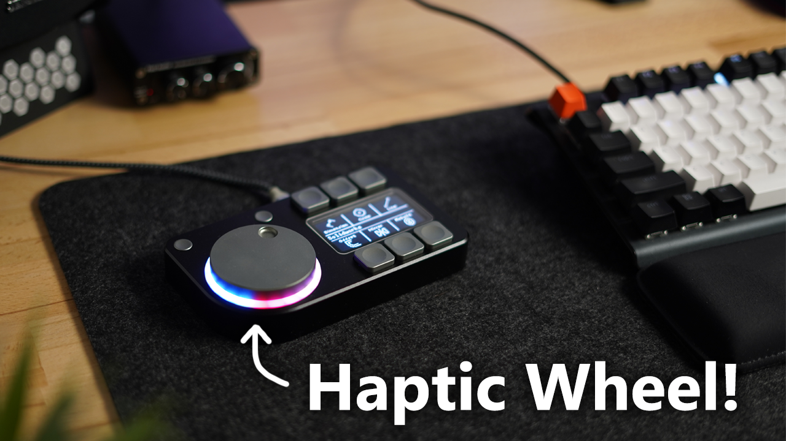

# HapticPad v2



A six-key macropad with an OLED label screen and a brushless wheel that
generates its detents in software — the clicks you feel are torque curves, not
a mechanical ratchet, so every profile can have a different feel.

Version 2 is a **ground-up firmware rewrite on the Raspberry Pi Pico SDK**,
plus a desktop configurator that sets up the whole device over the USB cable.
The hardware is unchanged from
[the original project by dmcke5](https://github.com/dmcke5/Hapticpad) — the
same two PCBs and the same printed parts run this firmware without any
rewiring.

## What is new in v2

| | v1 (Arduino) | v2 (Pico SDK) |
| --- | --- | --- |
| Macro delivery | `sendKeystroke()` called from both cores; reports lost | one core owns USB; queued, never dropped silently |
| Macro delays | `delay()` froze screen, LEDs and buttons | non-blocking playback, UI keeps running |
| Wheel zoom | broken (Ctrl written into the modifier byte as a keycode) | works, and is one preset among twelve |
| Display | bit-banged SPI, ~30 ms of blocked CPU per frame | PIO + DMA, ~1 ms, CPU free |
| LED ring | FastLED bit-bang with interrupts off | PIO + DMA |
| Encoder | 2 GPIO interrupts, up to 80 k/s | PIO decoder, zero interrupts |
| Macro steps | 3 per button | 8 per button |
| Config | XML on the card, edited by hand | on-device menu, USB configurator, or plain-text files |
| Firmware update | BOOTSEL button | menu entry or a button in the configurator |
| Icons | every `.bin` on the original card was 72 bytes of zeros | converter that verifies its own output |

Full details in [CHANGELOG.md](CHANGELOG.md); coming from a working v1 pad, read
[docs/migration-from-v1.md](docs/migration-from-v1.md) first.

## Features

- 6 macro keys, up to 8 steps each, with per-step delays
- Actions: key combinations, media keys, typed text, held modifiers, mouse
  buttons and scrolling
- 128×64 OLED with a 24×24 icon and a label per key
- Haptic wheel: 6 feel modes (`off free clicky ratchet damped 4points`) and 12
  function presets (scroll, zoom, volume, tabs, history, undo/redo, timeline…)
- 20-LED ring: `off solid rainbow breath bands halo reactive profile`
- Up to 32 profiles on the microSD card, switched from the keys or the menu
- On-device settings menu, with a screensaver that parks the motor
- USB serial protocol — the configurator uses it, and so can a terminal
- Live telemetry: FOC loop rate, HID queue depth, dropped reports

## Repository layout

```
firmware/      HapticPad 2.0 firmware — C/C++ on the Pico SDK
  release/     hapticpad-2.0.0.uf2, ready to flash
configurator/  desktop app: profiles, macros, icons, settings over USB
hardware/      PCBs (KiCad + gerbers), 3D printable and machinable parts, BOM
sd-card/       a starter card: config.txt, example profiles, icons
assets/        190+ PNG icons to import with the configurator
docs/          everything below
```

## Getting started

**1. Flash the firmware.** Hold BOOTSEL while plugging the pad in, then drag
`firmware/release/hapticpad-2.0.0.uf2` onto the `RPI-RP2` drive. That is the
last time you need the BOOTSEL button — afterwards the pad's menu and the
configurator can both reboot it into the bootloader.

**2. Prepare the card.** Copy the contents of `sd-card/` onto a FAT32 microSD
and insert it. See [docs/sd-card.md](docs/sd-card.md).

**3. Run the configurator.**

```bash
python3 configurator/hapticpad.py
```

No installation: it runs on the Python that ships with macOS and opens in your
browser. See [configurator/README.md](configurator/README.md).

Building the firmware yourself is in [firmware/README.md](firmware/README.md).

## Documentation

| Document | What it covers |
| --- | --- |
| [docs/hardware.md](docs/hardware.md) | BOM, PCB assembly, motor stack, wiring |
| [docs/sd-card.md](docs/sd-card.md) | card layout, what the firmware writes |
| [docs/profile-format.md](docs/profile-format.md) | profile keys, wheel modes, action vocabulary |
| [docs/configuration.md](docs/configuration.md) | device settings, and how profiles override them |
| [docs/serial-protocol.md](docs/serial-protocol.md) | the USB command set |
| [docs/architecture.md](docs/architecture.md) | how the two cores divide the work |
| [docs/migration-from-v1.md](docs/migration-from-v1.md) | upgrading a v1 pad |
| [docs/troubleshooting.md](docs/troubleshooting.md) | when something does not work |
| [firmware/README.md](firmware/README.md) | building, flashing, debugging |
| [configurator/README.md](configurator/README.md) | the desktop app |

## Credits and licence

The hardware, the enclosure and the original v1 firmware are the work of
**dmcke5** — [Hapticpad](https://github.com/dmcke5/Hapticpad),
[project video](https://youtu.be/bNUKRJQjuvQ). Version 2 is a firmware and
software rewrite on top of that hardware.

Licensed under the **CERN Open Hardware Licence v2 — Strongly Reciprocal**, the
same licence as the original project. See [LICENSE](LICENSE).
