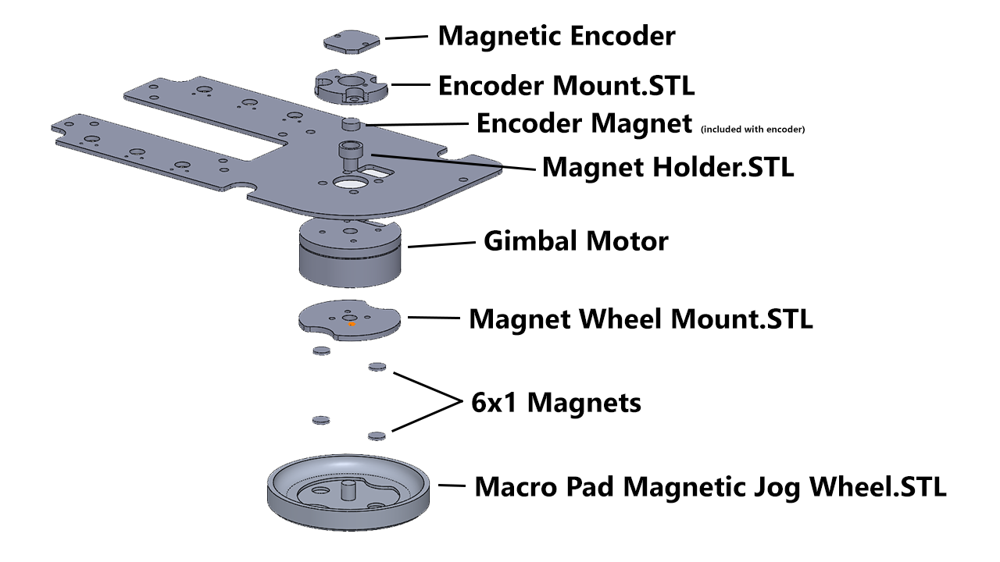

# Hardware

The hardware is unchanged from
[the original project by dmcke5](https://github.com/dmcke5/Hapticpad): the same
two PCBs, the same pin assignments, the same printed parts. A v1 pad runs the
v2 firmware without any rewiring. This page collects the build information;
the pin map is in [architecture.md](architecture.md#pin-map).

## Bill of materials

The full BOM with links is in [`hardware/bom/`](../hardware/bom/).

| Qty | Part |
| --- | --- |
| 1 | 128×64 OLED display — Waveshare 2.42" |
| 1 | Magnetic encoder board |
| 1 | 2804 100 kV brushless gimbal motor |
| 6 | Kailh low-profile switches |
| 1 | RP2040-Plus board (Waveshare) |
| 1 | TMC6300 motor driver board (SparkFun) |
| 1 | microSD module |
| 4 | 6×1 mm magnets |
| 2 | Tactile buttons — **EVQ-Q2B03W** |

Optional, for the LED ring:

| Qty | Part |
| --- | --- |
| 20 | WS2811 LEDs |
| 20 | 0.1 µF (100 nF) 0603 capacitors |

Fasteners:

| Qty | Part |
| --- | --- |
| 9 | M3×5×5 threaded inserts (printed housing only) |
| 3 | M3×6 SHCS |
| 2 | M3×10 SHCS |
| 10 | M2.5×4 SHCS |
| 4 | M3×6 CSK |

## Printing and machining

**Printed version** — print everything in [`hardware/3d/STL's/`](../hardware/3d/):
6× the keycap, 2× the menu button, 2× the PCB spacer.

**Machined version** — print everything in `STL's/` *except* `Custom
Keycap.STL`, `Macro Pad - Printed Version.STL` and `Menu Button Printed.STL`,
and have the `.STEP` files in [`hardware/3d/STEP/`](../hardware/3d/) machined.
Do not include the assembly `.STEP` from the top level — it is the complete
model, not a part. Supplying `Macro Pad Housing.pdf` with the housing lets the
shop tap the mounting holes for you.

## Motor assembly

`Encoder Mount.STL` has two small holes meant to be tapped M2 for the encoder.
Without an M2 tap, glue or small self-tapping screws hold it well enough.

The magnet holder should be a snug fit inside the hollow motor shaft. If it is
not, a drop of superglue keeps it from working free over time.

## PCBs

Both boards are two-layer and cheap to have made. Upload
[`hardware/pcb/MacroPad/Gerbers.zip`](../hardware/pcb/) and
`hardware/pcb/MacroPad Controller Board/Gerbers.zip` to any manufacturer; they
need nothing else. The KiCad sources are next to the gerbers.

### Controller board

The main components are labelled, and so are the power and ground pins of the
motor driver and the SD reader — check the orientation of both. The SD reader
sits flat against the PCB. The motor driver goes on its pin headers with the
*bottom* of the board face up (the side with the pin labels showing). The Pico
solders directly to the board with its USB port facing outwards.

C1 is specified as a 10000 pF 50 V capacitor. The original build left it
unfitted with no ill effects, but SparkFun recommends it and the pads are
there.

### Main board

If you are fitting the LEDs, do them first. Each LED has a corner with an
arrow-shaped rebate; it points *away* from the pad marked "1". Every `C`
component on this board is a 0.1 µF 0603 capacitor, and the LEDs will not work
without them.

The two profile-switch buttons must be **EVQ-Q2B03W**. They share a footprint
with the EVQ-Q2B02W but are taller, so check what you order.

### Connecting the two boards

All the pads on both PCBs are tiny through-holes — more robust for beginners
than surface pads. The hole is too small to pass the wire through, so treat
them as surface-mount pads.

The controller board has a group of pads labelled **Display**. Solder the cable
that came with your screen straight to them; the labels match the display's.

**Power the display from 3.3 V, not 5 V.** The Waveshare module accepts either,
but its TXS0108E level shifter references its input threshold to VCC. At 5 V
that threshold sits at about the RP2040's 3.3 V output, so clock edges are
missed at random: the screen stays black on some boots, shows only garbled
fragments on others, and gets worse while the motor and LEDs are drawing
current. At 3.3 V the same signals clear the threshold comfortably.

The two boards join with wires, label to label. Messy compared with a ribbon
cable, deliberately, to keep the build approachable.

The three motor wires go to **U**, **V** and **W** on the controller board. The
firmware detects the motor's direction at startup, so any order works — if it
misbehaves, swap two of them. The wheel direction can also be flipped in
software with `encoder_invert`.

The four encoder connections are labelled; the remaining pins on the encoder
board are unused.
